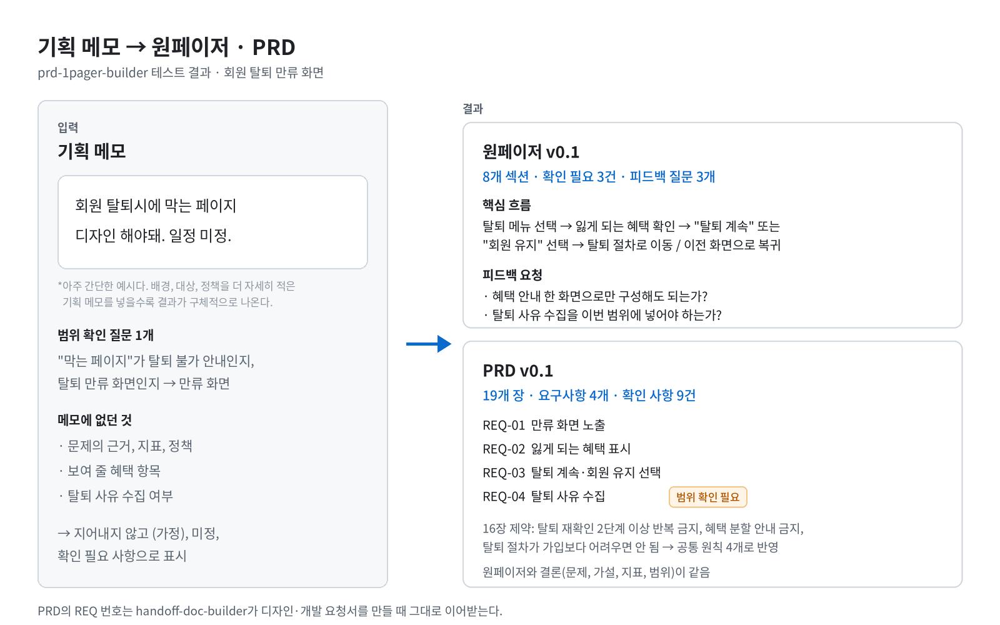
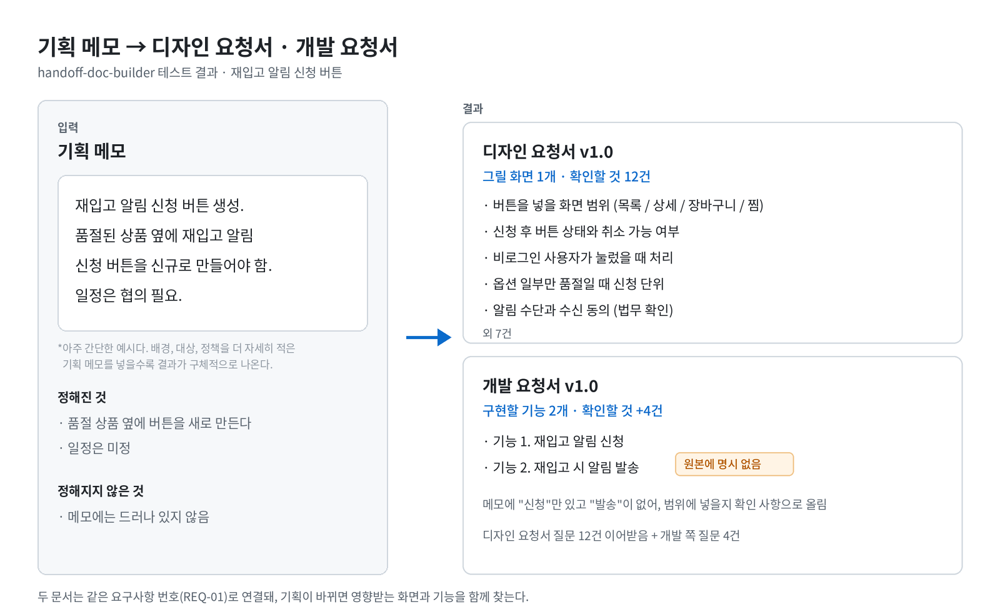

# Product Management Doc Skills

기획 메모를 원페이저, PRD, 디자인 요청서, 개발 요청서로 작성하는 Claude 스킬 모음입니다.

```
기획 메모 → 원페이저 → PRD → 디자인 요청서 / 개발 요청서
```

| 스킬 | 하는 일 |
|---|---|
| [prd-1pager-builder](skills/prd-1pager-builder) | 기획 메모를 원페이저와 PRD로 작성하고, 두 문서의 결론을 같게 유지 |
| [handoff-doc-builder](skills/handoff-doc-builder) | PRD를 디자인 요청서와 개발 요청서로 바꾸고, PRD가 바뀌면 두 문서를 동기화 |

Claude 스킬은 특정 업무의 작업 순서, 양식, 점검 기준을 묶은 폴더입니다. 설치해 두면 관련 요청이 들어왔을 때 Claude가 이 파일을 읽고 같은 방식으로 문서를 만듭니다.

## 결과 예시

### 메모 → 원페이저 + PRD (prd-1pager-builder)



한 줄짜리 메모([input-memo.md](examples/withdrawal-retention/input-memo.md))로 [원페이저](examples/withdrawal-retention/one-pager.md)와 [PRD](examples/withdrawal-retention/prd.md)를 만든 결과입니다. 메모에 없던 근거·지표·정책은 지어내지 않고 (가정), 미정, 확인 필요 사항으로 남겼습니다. 탈퇴 관련 법 기준은 작성 중에 별도로 찾아 확인한 내용을 16장 제약에 넣었습니다.

### 메모 → 디자인·개발 요청서 (handoff-doc-builder)



세 줄짜리 메모([input-memo.md](examples/restock-alert/input-memo.md))로 [디자인 요청서](examples/restock-alert/design-request.md)와 [개발 요청서](examples/restock-alert/dev-request.md)를 만든 결과입니다. 메모에 없던 "알림 발송" 기능이 개발 요청서 단계에서 빈 곳으로 드러났습니다.

## 스킬별 기능

### prd-1pager-builder

| 요청 | 결과 |
|---|---|
| "이 기획 원페이저 써줘" | 원페이저 |
| "이 기획 PRD 써줘" | PRD + 원페이저 |
| "이 원페이저로 PRD 써줘" | 원페이저 결론을 이어받은 PRD |
| "이 PRD 원페이저로 요약해줘" | PRD를 줄인 원페이저 |
| "이 PRD 점검해줘" | 점검표 기준 검토 결과 |

- PRD 19개 장: 요약, 배경, 주요 사용자, 문제, 원인 분석, 가설, 목표, 사용자 여정, 해결 방안, 기능 요구사항, 화면 목록, 제외 범위, 예외 처리, 필요한 데이터, 성공 지표, 제약·의존성·리스크, 출시와 검증, 확인 필요 사항, 관련 문서
- 원페이저 8개 섹션: 요약, 가설, 핵심 지표, 개발 범위, 제외 범위, 일정, 확인 필요 사항, 피드백 요청 사항
- 요청이 애매하면 원페이저부터 씁니다. 방향이 정해지기 전에 긴 문서를 쓰면 다시 쓸 양이 많기 때문입니다.

### handoff-doc-builder

| 요청 | 결과 |
|---|---|
| "디자인 요청서 만들어줘" | 화면별로 그려야 할 것과 상태(빈 화면, 오류 등) |
| "개발 요청서 만들어줘" | 기능별 동작 규칙, 데이터, 예외 처리, 완료 기준 |
| "PRD 바뀐 거 요청서에 반영해줘" | 바뀐 요구사항과 영향받는 화면·기능, 디자이너·개발자용 변경 안내 |
| "Jira 티켓으로 정리해줘" | 기능별 티켓 목록 (생성은 승인 후) |

## 문서 작성 규칙

두 스킬이 함께 따르는 규칙입니다.

- **요구사항 번호(REQ)로 문서를 잇습니다.** PRD의 요구사항에 `REQ-01` 번호를 붙이고, 디자인·개발 요청서도 같은 번호를 씁니다. PRD에서 REQ-03이 바뀌면 REQ-03이 연결된 화면과 기능만 고치면 됩니다.
- **모르는 내용은 지어내지 않습니다.** 근거 없는 주장에는 `(가정)`을 붙이고, 정해지지 않은 내용은 담당과 기한을 적어 확인 필요 사항으로 모읍니다.
- **AI가 쓴 티가 나지 않게 씁니다.** 뜻 없는 꾸밈말(다양한, 효과적으로), 번역투(~를 통해), 비유(한 축, 큰 그림)를 금지 목록으로 두고 점검표에서 확인합니다.
- **외부 도구에는 승인 후에만 만듭니다.** Notion, Jira, Google Docs 등에 새 문서나 티켓을 만들기 전에 사용자 승인을 받습니다.

## 설치

**Claude 앱 (claude.ai)**

스킬 폴더를 zip으로 압축해 Claude 앱의 스킬 설정에서 업로드합니다. 메뉴 위치는 앱 버전에 따라 다를 수 있습니다.

```bash
cd skills
zip -r prd-1pager-builder.zip prd-1pager-builder
zip -r handoff-doc-builder.zip handoff-doc-builder
```

**Claude Code**

```bash
cp -r skills/prd-1pager-builder ~/.claude/skills/
cp -r skills/handoff-doc-builder ~/.claude/skills/
```

## 사용법

스킬 이름을 부르거나, 문서 종류를 말하면 됩니다.

```
/prd-1pager-builder 장바구니에서 쿠폰을 적용할 수 있게 하고 싶어. 지금은 주문서에서만 돼서 할인 금액을 모르고 이탈하는 사람이 있음. 디자인 마감 11/14.
```

```
/handoff-doc-builder 이 PRD로 디자인 요청서랑 개발 요청서 둘 다 만들어줘. (PRD 첨부)
```

원페이저를 먼저 쓰고 나중에 PRD로 확장할 때는, 새 대화라면 기존 원페이저를 함께 첨부해야 내용을 이어받습니다.

## 폴더 구성

```
skills/
├── prd-1pager-builder/
│   ├── SKILL.md                    # 작업 순서, REQ 규칙, 문체 규칙
│   ├── templates/                  # PRD 양식, 원페이저 양식과 장 대응표
│   ├── review-checklists/          # PRD 점검표, 원페이저 점검표
│   └── examples/                   # 견본 PRD, 견본 원페이저
└── handoff-doc-builder/
    ├── SKILL.md                    # 문서 종류·작업 유형 판단, 동기화 규칙
    ├── request-prompts/            # 요청 유형별 필요한 입력
    ├── templates/                  # 디자인·개발 요청서 양식, 요구사항 매핑표
    └── review-checklists/          # 디자인·개발 요청서 점검표, 동기화 점검표
examples/                           # 스킬로 만든 결과 문서
├── restock-alert/                  # 메모 → 디자인·개발 요청서
├── withdrawal-retention/           # 메모 → PRD → 원페이저
└── cart-coupon/                    # 메모 → 원페이저
docs/images/
```

## 예시 문서

| 폴더 | 입력 | 결과 |
|---|---|---|
| [restock-alert](examples/restock-alert) | 세 줄 메모 | 디자인 요청서, 개발 요청서 |
| [withdrawal-retention](examples/withdrawal-retention) | 한 줄 메모 | PRD, 원페이저 |
| [cart-coupon](examples/cart-coupon) | 기획 메모 | 원페이저 (PRD 없이 먼저 작성) |

예시의 서비스, 수치, 사례는 모두 가상입니다.

## 남은 과제

- 실제 업무 문서로 테스트하며 양식 다듬기
- 기능 규모에 따라 PRD 장 구성을 줄이는 방법
- Notion, Jira 연동으로 문서와 작업 티켓 바로 만들기

## 라이선스

[CC BY 4.0](https://creativecommons.org/licenses/by/4.0/deed.ko) 라이선스를 따릅니다. 누구나 복사, 수정, 상업적 이용을 할 수 있습니다. 다만 아래처럼 출처를 표시해 주세요.

> 원작: yuminkim101, [product-management-doc-skills](https://github.com/yuminkim101/product-management-doc-skills), CC BY 4.0

수정해서 쓰는 경우 수정했다는 사실도 함께 적어 주세요.
